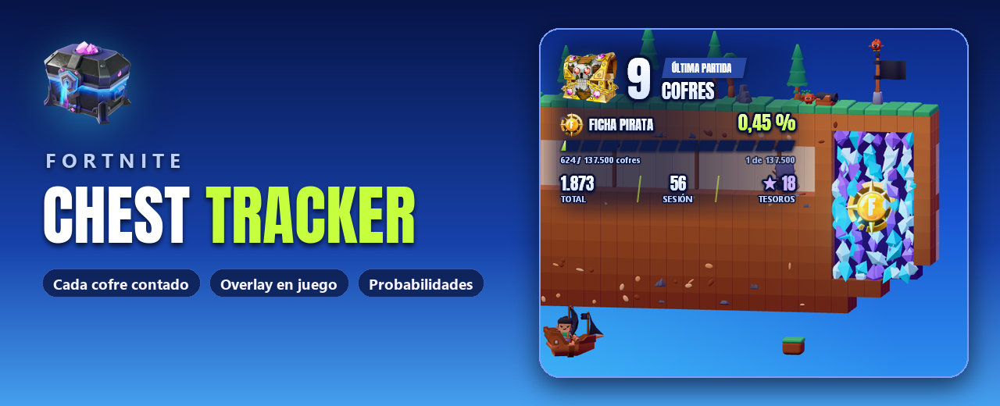
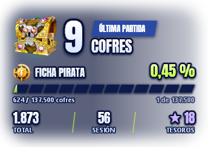
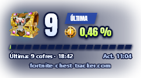
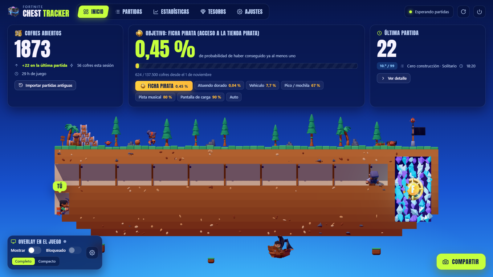
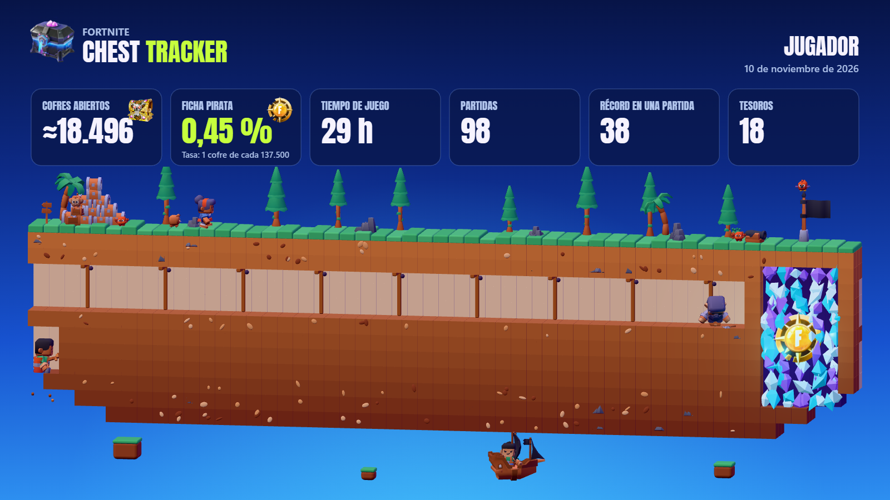
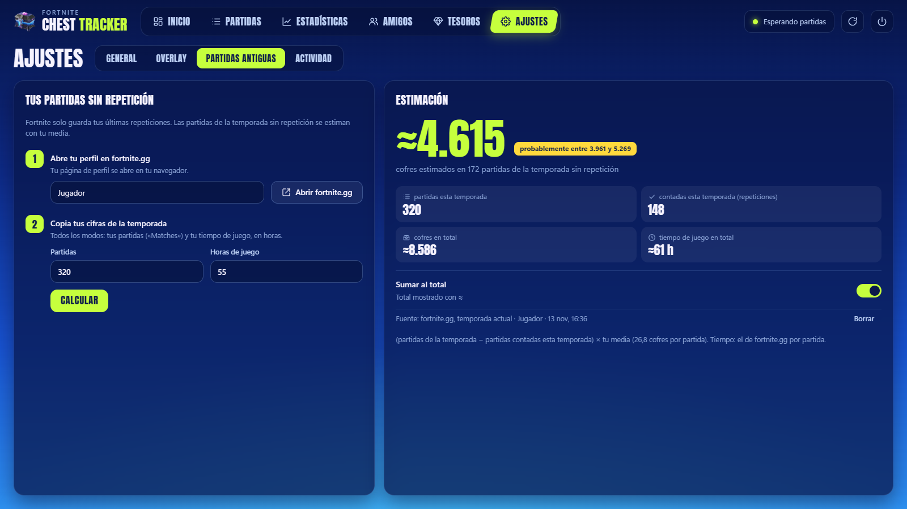

<a href="README.md">English</a> · <a href="README.fr.md">Français</a> · <b>Español</b>

  
  

  
  
  
  

<h3 align="center">¿Cuántos cofres has abierto de verdad?</h3>

Chest Tracker cuenta cada cofre que abres en Fortnite, partida tras partida, 
lo muestra encima del juego y te dice tu probabilidad de conseguir la ficha pirata.

---

## Listo en 3 pasos

| | | |
|:---:|:---:|:---:|
| **1 · Activa las repeticiones** | **2 · Abre la app** | **3 · Juega** |
| En Fortnite: *Ajustes → Juego → Repeticiones → Grabar repeticiones: **Sí***. El tracker lee esos archivos, nada más. | Descarga **`FortniteChestTracker.exe`** y ábrelo. Una breve instalación se abre en tu navegador (idioma, carpeta de repeticiones, repeticiones existentes). | Cada partida se cuenta **unos segundos después del final**. El tracker espera junto al reloj, sin ventana. |

> [!NOTE]
> El exe no está firmado, así que Windows puede mostrar *«Windows protegió su PC»*: haz clic en **Más información → Ejecutar de todas formas**.

---

## El HUD, directamente sobre el juego

  
  &nbsp;&nbsp;&nbsp;
  

Sin ventana ni marco: solo cifras con contorno sobre un halo suave, legibles en cualquier parte del mapa. Elige **Completo** o **Compacto**.

- **La cifra grande**: los cofres de tu última partida. Fortnite solo deja leer la repetición cuando termina la partida, así que llegan unos segundos después del final, de golpe (con un «+N»). Durante la partida: **PARTIDA EN CURSO**.
- **Tu objetivo**: el tesoro elegido (ficha pirata por defecto), tu probabilidad hasta ahora y cuánto has «excavado».
- **Total · Sesión · Tesoros** abajo del HUD completo.

| Atajo (funciona en el juego) | |
|---|---|
| **Ctrl+Mayús+O** | Mostrar / ocultar |
| **Ctrl+Mayús+L** | Bloquear (el ratón lo atraviesa) / desbloquear (arrástralo donde quieras y pulsa el candado) |
| Clic derecho | Ocultar |

Pon Fortnite en **Pantalla completa en ventana** para verlo (*Ajustes → Vídeo → Modo de ventana*). Tamaño (70–175 %) y opacidad se ajustan en la app. **¿Haces streaming?** `overlay.html` es exactamente el mismo HUD con fondo transparente, para una fuente de navegador de OBS.

---

## Tus estadísticas, en una página que se llena sola

Una página local (`http://127.0.0.1:5317`, solo tu PC puede abrirla) que se actualiza sola. Cinco pestañas, teclas **1** a **5**:

| Pestaña | |
|---|---|
| 🏠 **Inicio** | Tu total, tu probabilidad para el tesoro buscado, tu última partida, sobre una pequeña isla en 3D donde tu minero excava hacia el tesoro. Los interruptores del overlay están ahí mismo. |
| 📋 **Partidas** | Todas tus partidas, por modo. Abre una: cofres por tipo y rareza, eliminaciones, duración y tu saqueo minuto a minuto (primer cofre, cofres de los 5 primeros minutos). |
| 📈 **Estadísticas** | Media, mejor partida, mejor día, victorias magistrales, cofres por día, tipos de cofre. **¿Los cofres te hacen ganar?** (tu puesto según el número de cofres) y tus **hitos** (anunciados al alcanzarlos). |
| 💎 **Tesoros** | Las tasas de Epic, tu probabilidad para cada uno, lo que encontraste y **tu suerte hasta ahora** (más suerte que el X % de los jugadores). Ponles nombre a tus recompensas. |
| ⚙️ **Ajustes** | Idioma, abrir con Fortnite, instalar en este PC, overlay, **archivo de repeticiones**, partidas antiguas, actividad, actualizaciones. |

La isla está viva: una capitana y su perro, cangrejos, un mono, un loro, un barco, un cañón que dispara cuando se cuenta una partida. Haz clic en ellos.

---

## La búsqueda del tesoro, con las tasas reales de Epic

Por cofre abierto en una partida normal, según Epic:

| Tesoro | 1 cofre de cada | Horas del tesoro |
|---|---:|:---:|
| Artilugio | 127 | |
| Pantalla de carga de la semana | 272 | |
| Pista musical de la semana | 391 | |
| Pico o mochila de la semana | 568 | |
| Vehículo y calcomanía de la semana | 7.813 | ×10 |
| **Acceso a la tienda pirata (ficha pirata)** | **137.500** | ×1,5 |
| Atuendo dorado de la semana | 1.562.500 | ×7,5 |

Tu probabilidad de haber conseguido al menos uno = **1 − (1 − 1/tasa)cofres**, con tus cofres desde el inicio de la temporada. Elige tu objetivo en el inicio (o **Auto**: el próximo hito); el túnel 3D y el HUD lo siguen.

---

## Presúmelo

El botón **Compartir** crea esta imagen con tus estadísticas y la isla, con el objetivo que elijas. Descárgala o cópiala y pégala donde quieras.

---

## Las partidas más antiguas que tus repeticiones

Fortnite solo guarda tus últimas repeticiones. La sección **Partidas antiguas** estima el resto: toma tus partidas jugadas de fortnite.gg (o automáticamente con una clave gratuita de [fortnite-api.com](https://dash.fortnite-api.com/account)), y la app multiplica las partidas que faltan por **tu propia** media por modo, con un rango. Puedes sumarlo al total, mostrado con «≈».

---

## Seguro por diseño

| | |
|:---:|---|
| ✅ | Lee los archivos `.replay` que Fortnite escribe tras cada partida, **solo lectura**. |
| ❌ | Nunca toca el juego: ni lectura de memoria, ni inyección, ni archivos modificados. |
| ❌ | Sin inicio de sesión, sin cuenta de Epic, sin telemetría. Único acceso a la red: buscar actualizaciones en GitHub (desactivable). |
| ✅ | Funciona con prioridad baja, duerme entre partidas y ralentiza su escena 3D mientras juegas. |

---

## Preguntas frecuentes

<b>No se cuenta nada</b>

Comprueba que las repeticiones están activadas en Fortnite y que el tracker está abierto al final de la partida. Activa **Abrir con Fortnite** en los ajustes para no olvidarlo nunca: un pequeño proceso abre el tracker con el juego y lo cierra 30 s después del juego.

<b>¿Por qué unos segundos después de la partida y no durante?</b>

Fortnite solo escribe la clave que desbloquea una repetición al final de la partida. Hasta entonces, el HUD muestra **PARTIDA EN CURSO**.

<b>¿Qué cuenta como cofre?</b>

Los cofres que abres o destruyes. Un cofre que se rellena durante la partida y vuelves a abrir cuenta otra vez. Las cajas de munición, las de comida y los cañones de botín no son cofres. Solo se cuentan las partidas Battle Royale.

<b>¿Cómo se detectan los tesoros?</b>

Un premio de la búsqueda del tesoro hace aparecer un cofre dorado con el identificador del premio: el tracker lo lee en la repetición. Cada tesoro que recibes también se registra con el cofre del que salió (los de tus compañeros no son tuyos). Sin cofre dorado, la repetición no dice si un tesoro es un artilugio o una recompensa semanal (ambos pasan por el mismo mecanismo genérico): aparece como «Tesoro (artilugio o recompensa)» y tu suerte se calcula con todos los tesoros juntos. Renómbralos en la pestaña **Tesoros** (`treasures.json`).

<b>¿Varias cuentas de Fortnite en un PC?</b>

Cada cuenta tiene su propio perfil, que eliges en el menú de arriba de la página. Ninguna partida se pierde: va a la cuenta que la jugó.

<b>«No se puede leer esta repetición»</b>

Una actualización de Fortnite puede cambiar el formato de las repeticiones. Las partidas ya contadas se conservan. <a href="https://github.com/ayman-studio/fortnite-chest-tracker/issues">Abre una incidencia</a> y adjunta `errors.log`.

<b>No encuentro la app</b>

Está junto al reloj de Windows (un icono de cofre, a veces oculto tras la flecha **^**). Volver a abrir `FortniteChestTracker.exe` reabre la página.

---

<b>Bajo el capó</b>: datos, instalación, actualizaciones, compilación

### Datos

Todo está en `%APPDATA%\FortniteChestTracker`. Haz una copia de `data.json` si cambias de PC (se guarda un `.bak` de la versión anterior al lado). **Archivar mis repeticiones** (Ajustes) guarda una copia de cada repetición contada, en `Documents\Fortnite Chest Tracker\Replays` por defecto, antes de que Fortnite la borre.

| Archivo | |
|---|---|
| `data.json` | Todo tu historial |
| `config.json` | Ajustes (idioma, overlay, objetivo, inicio de temporada `TokenSinceUtc`…) |
| `treasures.json` | Nombres de los premios |
| `overlay.html` | El HUD para OBS |
| `errors.log` | Detalles de las repeticiones ilegibles |

### Instalar en este PC

Opcional (instalación o Ajustes → General): el exe se copia en `%LOCALAPPDATA%\Programs\Fortnite Chest Tracker` (sin derechos de administrador), con accesos directos en el menú Inicio y el escritorio, y una entrada en las aplicaciones instaladas de Windows. Desinstalación desde los ajustes o desde Windows: el programa se va, tus datos en `%APPDATA%\FortniteChestTracker` se quedan.

### Actualizaciones

Al iniciarse, la app consulta las releases de este repositorio. El botón **Instalar** descarga la nueva versión, comprueba su huella SHA-256 y reinicia; tu historial se conserva. *Propuestas* (por defecto), *automáticas* (entre dos partidas) o *desactivadas*, en los ajustes.

### Compilación

Instala el [SDK de .NET 10](https://dotnet.microsoft.com/download/dotnet/10.0) y ejecuta **`build.bat`** (escribe `dist\FortniteChestTracker.exe`). Pruebas: `dotnet test FortniteChestTracker.slnx` (`FCT_TEST_REPLAYS=<carpeta>` añade las pruebas con repeticiones reales; con `FCT_REPLAY_SUMMARY=<archivo.json>` se analiza toda la carpeta y se resume en ese archivo, para comparar dos versiones). GitHub Actions prueba cada push y publica una release por cada tag `v*`.

---

**Créditos.** 3D con three.js, personajes, animales, decorados y cursores de Kenney, fuente Anton, y una lectura de repeticiones basada en un proyecto de código abierto: sus licencias están en [THIRD-PARTY-NOTICES.txt](THIRD-PARTY-NOTICES.txt). Licencia: el código de este proyecto está bajo [MIT](LICENSE); el descompresor de repeticiones que incluye está bajo GPL-3.0, así que el exe descargable se distribuye bajo GPL-3.0 (texto completo en los avisos).

Imágenes de Fortnite (cofre reliquia, cofres piratas, ficha pirata) © Epic Games, usadas según la [Fan Content Policy de Epic Games](https://www.epicgames.com/site/en-US/fan-art-policy). No afiliado, respaldado ni patrocinado por Epic Games. Fortnite es una marca comercial de Epic Games, Inc.

