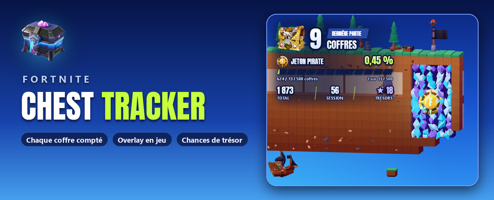
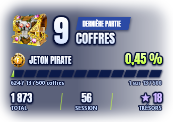
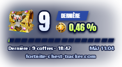
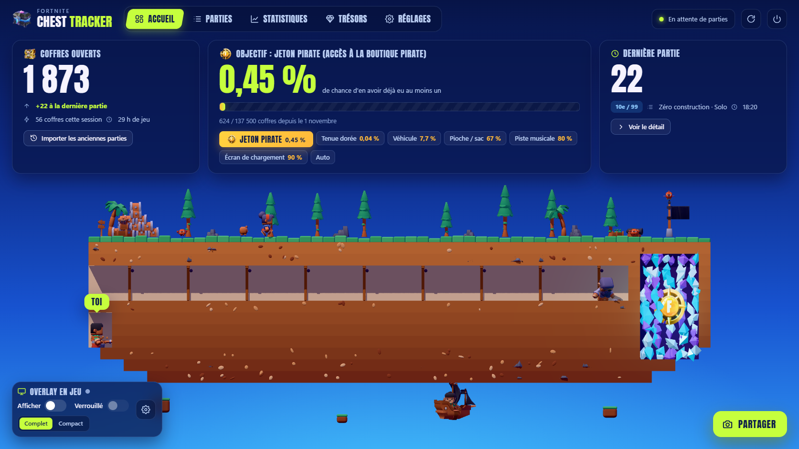
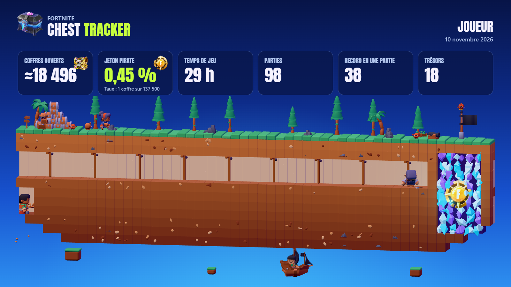
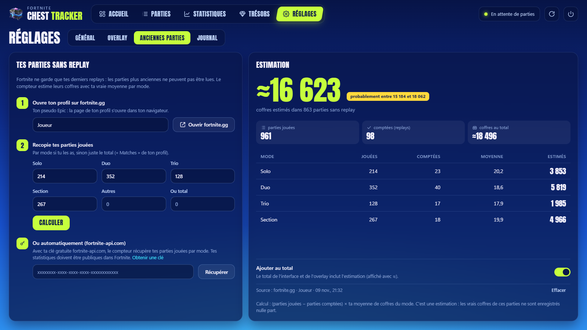

<a href="README.md">English</a> · <b>Français</b> · <a href="README.es.md">Español</a>

  
  

  
  
  
  

<h3 align="center">Combien de coffres as-tu vraiment ouverts ?</h3>

Chest Tracker compte chaque coffre que tu ouvres dans Fortnite, partie après partie, 
l'affiche par-dessus le jeu, et te donne tes chances d'avoir le jeton pirate.

---

## Prêt en 3 étapes

| | | |
|:---:|:---:|:---:|
| **1 · Active les replays** | **2 · Lance l'appli** | **3 · Joue** |
| Dans Fortnite : *Paramètres → Jeu → Replays → Enregistrer les replays : **Activé***. Le tracker lit ces fichiers, rien d'autre. | Télécharge **`FortniteChestTracker.exe`** et lance-le. Une courte installation s'ouvre dans ton navigateur (langue, dossier de replays, replays déjà présents). | Chaque partie est comptée **quelques secondes après la fin**. Le tracker attend à côté de l'horloge, sans fenêtre. |

> [!NOTE]
> L'exe n'est pas signé, Windows peut donc afficher *« Windows a protégé votre ordinateur »* : clique sur **Informations complémentaires → Exécuter quand même**.

---

## Le HUD, directement sur le jeu

  
  &nbsp;&nbsp;&nbsp;
  

Pas de fenêtre, pas de cadre : juste des chiffres détourés sur un halo doux, lisibles partout sur la carte. Au choix, **Complet** ou **Compact**.

- **Le gros chiffre** : les coffres de ta dernière partie. Fortnite ne laisse lire le replay qu'une fois la partie finie : ils arrivent donc quelques secondes après la fin, d'un coup (avec un « +N »). Pendant la partie : **PARTIE EN COURS**.
- **Ton objectif** : le trésor choisi (jeton pirate par défaut), ta chance jusqu'ici et où tu en es dans ta « fouille ».
- **Total · Session · Trésors** en bas du HUD complet.

| Raccourci (marche en jeu) | |
|---|---|
| **Ctrl+Maj+O** | Afficher / masquer |
| **Ctrl+Maj+L** | Verrouiller (la souris passe au travers) / déverrouiller (glisse-le où tu veux, puis clique sur le cadenas) |
| Clic droit | Masquer |

Mets Fortnite en **Plein écran fenêtré** pour le voir (*Paramètres → Vidéo → Mode de fenêtre*). Taille (70–175 %) et opacité se règlent dans l'appli. **Tu streames ?** `overlay.html` est exactement le même HUD à fond transparent, pour une source navigateur OBS.

---

## Tes stats, dans une page qui se remplit toute seule

Une page locale (`http://127.0.0.1:5317`, seul ton PC peut l'ouvrir) qui se met à jour toute seule. Cinq onglets, touches **1** à **5** :

| Onglet | |
|---|---|
| 🏠 **Accueil** | Ton total, ta chance pour le trésor visé, ta dernière partie, sur une petite île en 3D où ton mineur creuse vers le trésor. Les interrupteurs de l'overlay sont juste là. |
| 📋 **Parties** | Toutes tes parties, par mode. Ouvres-en une : coffres par type et rareté, éliminations, durée, et ton pillage minute par minute (premier coffre, coffres des 5 premières minutes). |
| 📈 **Statistiques** | Moyenne, meilleure partie, meilleur jour, Top 1, coffres par jour, types de coffres. **Les coffres font-ils gagner ?** (ta place selon le nombre de coffres) et tes **paliers** (annoncés quand tu en passes un). |
| 💎 **Trésors** | Les taux d'Epic, ta chance pour chacun, ce que tu as trouvé, et **ta chance jusqu'ici** (plus chanceux que X % des joueurs). Donne un nom à tes récompenses. |
| ⚙️ **Réglages** | Langue, ouverture avec Fortnite, installation sur ce PC, overlay, **archive des replays**, anciennes parties, activité, mises à jour. |

L'île est vivante : une capitaine et son chien, des crabes, un singe, un perroquet, un bateau, un canon qui tire quand une partie est comptée. Clique dessus.

---

## La chasse au trésor, avec les vrais taux d'Epic

Par coffre ouvert en partie normale, tels qu'annoncés par Epic :

| Trésor | 1 coffre sur | Heures du trésor |
|---|---:|:---:|
| Gadget | 127 | |
| Écran de chargement de la semaine | 272 | |
| Piste musicale de la semaine | 391 | |
| Pioche ou sac à dos de la semaine | 568 | |
| Véhicule et décalcomanie de la semaine | 7 813 | ×10 |
| **Accès à la boutique pirate (jeton pirate)** | **137 500** | ×1,5 |
| Tenue dorée de la semaine | 1 562 500 | ×7,5 |

Ta chance d'en avoir eu au moins un = **1 − (1 − 1/taux)coffres**, avec tes coffres depuis le début de la saison. Choisis ton objectif sur l'accueil (ou **Auto** : le prochain palier) ; le tunnel 3D et le HUD le suivent.

---

## Montre-le

Le bouton **Partager** crée cette image à partir de tes stats et de l'île, avec l'objectif de ton choix. Télécharge-la ou copie-la, puis colle-la où tu veux.

---

## Les parties plus anciennes que tes replays

Fortnite ne garde que tes derniers replays. La section **Anciennes parties** estime le reste : récupère tes parties jouées sur fortnite.gg (ou automatiquement avec une clé gratuite [fortnite-api.com](https://dash.fortnite-api.com/account)), et l'appli multiplie les parties manquantes par **ta propre** moyenne par mode, avec une fourchette. Tu peux l'ajouter au total, affiché avec « ≈ ».

---

## Sûr par conception

| | |
|:---:|---|
| ✅ | Lit les fichiers `.replay` que Fortnite écrit après chaque partie, **en lecture seule**. |
| ❌ | Ne touche jamais au jeu : aucune lecture de mémoire, aucune injection, aucun fichier modifié. |
| ❌ | Pas de connexion, pas de compte Epic, pas de télémétrie. Accès réseau : les mises à jour (GitHub), le calendrier de la saison, et l'onglet Potes : ton pseudo Epic, ton skin et tes coffres, vus seulement par les potes que tu acceptes (un bouton coupe tout et les efface du serveur). |
| ✅ | Tourne en priorité basse, dort entre les parties, ralentit sa scène 3D pendant que tu joues. |

---

## FAQ

<b>Rien n'est compté</b>

Vérifie que les replays sont activés dans Fortnite, et que le tracker tourne à la fin de la partie. Active **Ouvrir avec Fortnite** dans les réglages pour ne jamais l'oublier : un tout petit processus lance le tracker avec le jeu et le ferme 30 s après le jeu.

<b>Pourquoi quelques secondes après la partie, et pas pendant ?</b>

Fortnite n'écrit la clé qui déverrouille un replay qu'à la fin de la partie. D'ici là, le HUD affiche **PARTIE EN COURS**.

<b>Qu'est-ce qui compte comme coffre ?</b>

Les coffres que tu ouvres ou détruis. Un coffre rechargé pendant la partie et rouvert compte à nouveau. Les caisses de munitions, caisses de nourriture et canons à butin ne sont pas des coffres. Seules les parties Battle Royale sont comptées.

<b>Comment les trésors sont-ils détectés ?</b>

Une récompense de la chasse au trésor fait apparaître un coffre doré portant l'identifiant du lot : le tracker le lit dans le replay. Chaque trésor reçu est aussi enregistré avec le coffre d'où il vient (ceux de tes coéquipiers ne sont pas les tiens). Sans coffre doré, le replay ne dit pas si un trésor est un gizmo ou une récompense de la semaine (les deux passent par le même mécanisme générique) : il s'affiche « Trésor (gizmo ou récompense) » et ta chance est calculée sur tous les trésors ensemble. Renomme-les dans l'onglet **Trésors** (`treasures.json`).

<b>Plusieurs comptes Fortnite sur un PC ?</b>

Chaque compte a son propre profil, à choisir dans le menu en haut de la page. Aucune partie n'est perdue : elle va au compte qui l'a jouée.

<b>« Impossible de lire ce replay »</b>

Une mise à jour de Fortnite peut changer le format des replays. Les parties déjà comptées sont conservées. <a href="https://github.com/ayman-studio/fortnite-chest-tracker/issues">Ouvre un ticket</a> avec `errors.log` en pièce jointe.

<b>Je ne trouve plus l'appli</b>

Elle est à côté de l'horloge Windows (une icône de coffre, parfois cachée derrière la flèche **^**). Relancer `FortniteChestTracker.exe` rouvre la page.

---

<b>Sous le capot</b> : données, installation, mises à jour, compilation

### Données

Tout est dans `%APPDATA%\FortniteChestTracker`. Sauvegarde `data.json` si tu changes de PC (une copie `.bak` de la version précédente est gardée à côté). **Archiver mes replays** (Réglages) garde une copie de chaque replay compté, dans `Documents\Fortnite Chest Tracker\Replays` par défaut, avant que Fortnite ne l'efface.

| Fichier | |
|---|---|
| `data.json` | Tout ton historique |
| `config.json` | Réglages (langue, overlay, objectif, début de saison `TokenSinceUtc`…) |
| `treasures.json` | Noms des récompenses |
| `overlay.html` | Le HUD pour OBS |
| `errors.log` | Détails des replays illisibles |

### Installer sur ce PC

Au choix (installation ou Réglages → Général) : l'exe est copié dans `%LOCALAPPDATA%\Programs\Fortnite Chest Tracker` (sans droits admin), avec des raccourcis dans le menu Démarrer et sur le bureau, et une entrée dans les applications installées de Windows. Désinstallation depuis les réglages ou depuis Windows : le programme part, tes données dans `%APPDATA%\FortniteChestTracker` restent.

### Mises à jour

Au démarrage, l'appli regarde les releases de ce dépôt. Le bouton **Installer** télécharge la nouvelle version, vérifie son empreinte SHA-256 et redémarre ; ton historique est conservé. *Proposées* (par défaut), *automatiques* (entre deux parties) ou *désactivées*, dans les réglages.

### Compilation

Installe le [SDK .NET 10](https://dotnet.microsoft.com/download/dotnet/10.0), puis lance **`build.bat`** (écrit `dist\FortniteChestTracker.exe`). Tests : `dotnet test FortniteChestTracker.slnx` (`FCT_TEST_REPLAYS=<dossier>` ajoute les tests sur de vrais replays ; avec `FCT_REPLAY_SUMMARY=<fichier.json>`, tout le dossier est analysé et résumé dans ce fichier, pour comparer deux versions). GitHub Actions teste chaque push et publie une release pour chaque tag `v*`.

---

**Crédits.** 3D avec three.js, personnages, animaux, décors et curseurs de Kenney, police Anton, et une lecture des replays basée sur un projet open source : leurs licences sont dans [THIRD-PARTY-NOTICES.txt](THIRD-PARTY-NOTICES.txt). Licence : le code de ce projet est sous [MIT](LICENSE) ; le décompresseur de replays qu'il inclut est sous GPL-3.0, donc l'exe téléchargeable est distribué sous GPL-3.0 (texte complet dans les notices).

Images Fortnite (coffre relique, coffres pirates, jeton pirate) © Epic Games, utilisées selon la [Fan Content Policy d'Epic Games](https://www.epicgames.com/site/en-US/fan-art-policy). Ni affilié, ni approuvé, ni sponsorisé par Epic Games. Fortnite est une marque d'Epic Games, Inc.

