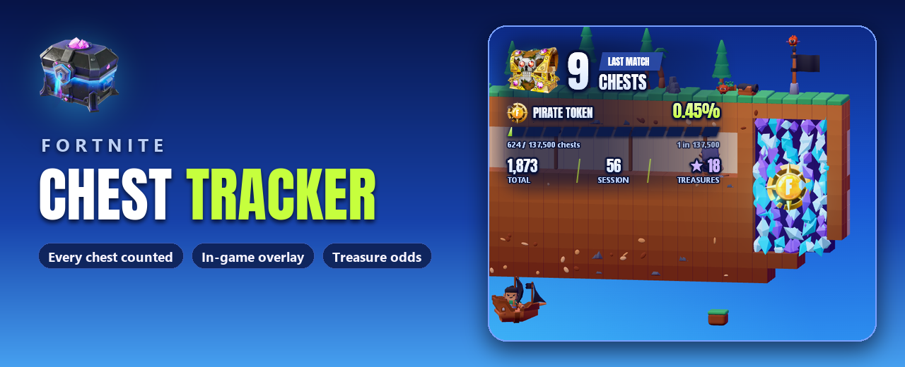
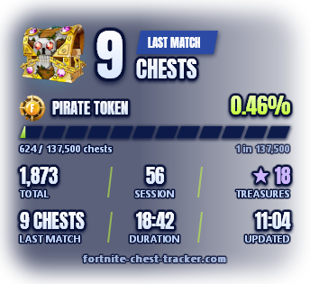
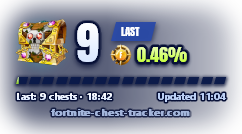
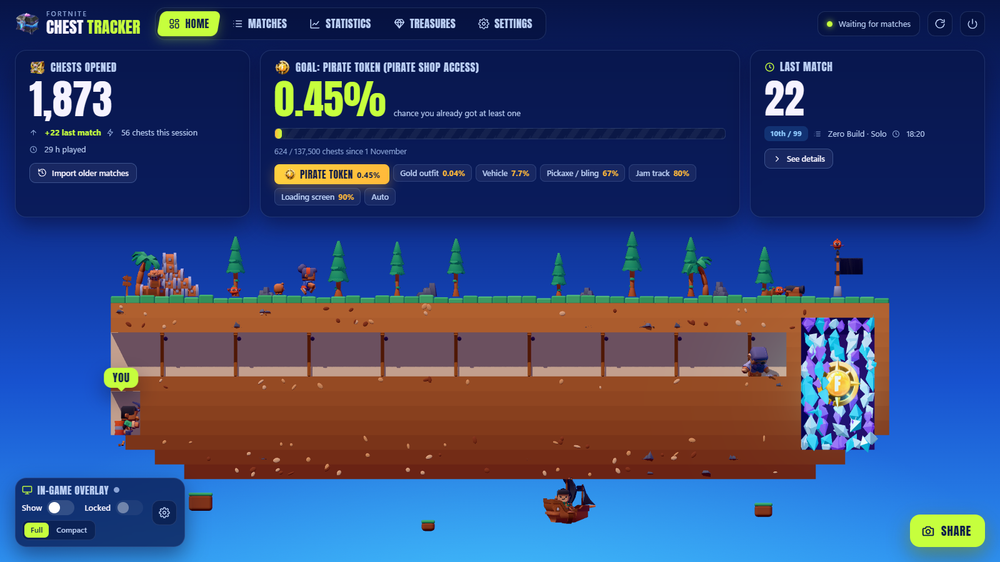
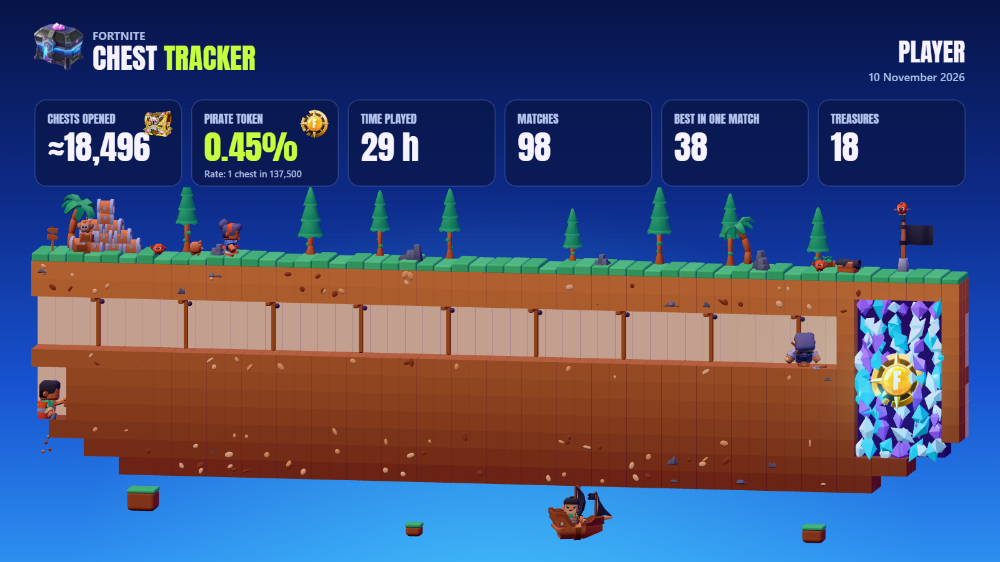
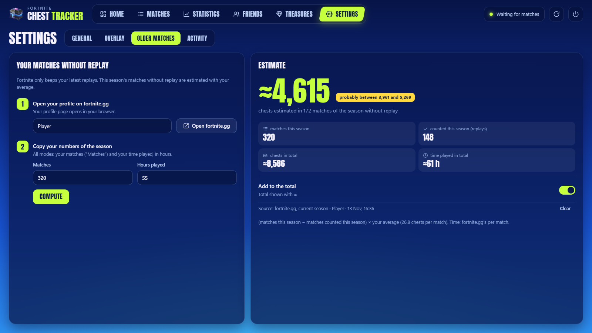

<b>English</b> · <a href="README.fr.md">Français</a> · <a href="README.es.md">Español</a>

  
  
  

  
  
  
  

<h3 align="center">How many chests have you really opened?</h3>

Chest Tracker counts every chest you open in Fortnite, match after match, 
shows it on top of the game, and tells you your odds of landing the pirate token.

---

## Up and running in 3 steps

| | | |
|:---:|:---:|:---:|
| **1 · Turn on replays** | **2 · Run the app** | **3 · Play** |
| In Fortnite: *Settings → Game → Replays → Record Replays: **On***. The tracker reads these files, nothing else. | Download **`FortniteChestTracker.exe`** and run it. A short setup opens in your browser (language, replays folder, existing replays). | Each match is counted **a few seconds after it ends**. The tracker waits next to the clock, with no window. |

> [!NOTE]
> The exe is not signed, so Windows may say *"Windows protected your PC"*: click **More info → Run anyway**.

---

## The HUD, right over the game

  
  &nbsp;&nbsp;&nbsp;
  

No window, no frame: just outlined numbers on a soft halo, readable anywhere on the map. Pick **Full** or **Compact**.

- **The big number**: chests of your last match. Fortnite only lets its replay be read once the match is over, so they land a few seconds after the end, all at once (a "+N" pops). During a match: **MATCH IN PROGRESS**.
- **Your goal**: the treasure you chose (pirate token by default), your chance so far and how far you have "dug".
- **Total · Session · Treasures** at the bottom of the full HUD.

| Shortcut (works in game) | |
|---|---|
| **Ctrl+Shift+O** | Show / hide |
| **Ctrl+Shift+L** | Lock (the mouse goes through it) / unlock (drag it anywhere, then click the padlock) |
| Right-click | Hide |

Set Fortnite to **Windowed Fullscreen** to see it (*Settings → Video → Window Mode*). Size (70–175 %) and opacity are set in the app. **Streaming?** `overlay.html` is the very same HUD with a transparent background, for an OBS browser source.

---

## Your stats, in a page that builds itself

A local page (`http://127.0.0.1:5317`, only your PC can open it) that updates by itself. Five tabs, keys **1** to **5**:

| Tab | |
|---|---|
| 🏠 **Home** | Your total, your chance for the treasure you aim at, your last match, over a little 3D island where your miner digs towards the treasure. The overlay switches are right there. |
| 📋 **Matches** | Every match, by mode. Open one: chests by type and rarity, eliminations, duration, and your looting minute by minute (first chest, chests in the first 5 minutes). |
| 📈 **Statistics** | Average, best match, best day, Victory Royales, chests per day, chest types. **Do chests help you win?** (your placement by number of chests) and your **milestones** (announced when you reach one). |
| 💎 **Treasures** | Epic's drop rates, your chance for each one, what you found, and **your luck so far** (luckier than X% of players). Name your rewards. |
| ⚙️ **Settings** | Language, open with Fortnite, install on this PC, overlay, **replay archive**, older matches, activity, updates. |

The island is alive: a captain and her dog, crabs, a monkey, a parrot, a ship, a cannon that fires when a match is counted. Click them.

---

## The treasure hunt, with Epic's real odds

Per chest opened in a normal match, as announced by Epic:

| Treasure | 1 chest in | Treasure Hours |
|---|---:|:---:|
| Gizmo | 127 | |
| Weekly loading screen | 272 | |
| Weekly jam track | 391 | |
| Weekly pickaxe or back bling | 568 | |
| Weekly vehicle & decal | 7,813 | ×10 |
| **Pirate Shop Access (pirate token)** | **137,500** | ×1.5 |
| Weekly gold outfit | 1,562,500 | ×7.5 |

Your chance of having dropped one at least once = **1 − (1 − 1/rate)chests**, with your chests since the season started. Choose your goal on the home page (or **Auto**: the next milestone); the 3D tunnel and the HUD follow it.

---

## Show it off

The **Share** button makes this picture from your stats and the island, with the goal of your choice. Download it or copy it, then paste it anywhere.

---

## Matches older than your replays

Fortnite only keeps your latest replays. The **Older matches** section estimates the rest: take your matches played from fortnite.gg (or fetch them with a free [fortnite-api.com](https://dash.fortnite-api.com/account) key), and the app multiplies the missing matches by **your own** average per mode, with a range. You can add it to the total, shown with "≈".

---

## Safe by design

| | |
|:---:|---|
| ✅ | Reads the `.replay` files Fortnite writes after each match, **read-only**. |
| ❌ | Never touches the game: no memory reading, no injection, no file modified. |
| ❌ | No login, no Epic account, no telemetry. Network use: updates (GitHub), the season calendar, and the Friends tab: your Epic name, outfit and chests, seen only by the friends you accept (one switch turns it off and deletes them from the server). |
| ✅ | Runs at low priority, sleeps between matches, slows its 3D scene down while you play. |

---

## FAQ

<b>Nothing is counted</b>

Check that replays are on in Fortnite, and that the tracker runs when the match ends. Turn on **Open with Fortnite** in the settings so you never forget: a tiny background process starts the tracker with the game and closes it 30 s after the game.

<b>Why a few seconds after the match, not during it?</b>

Fortnite only writes the key that unlocks a replay when the match ends. Until then the HUD says **MATCH IN PROGRESS**.

<b>What counts as a chest?</b>

Chests you open or destroy. A chest refilled during the match and opened again counts again. Ammo boxes, food boxes and loot cannons are not chests. Only Battle Royale matches are counted.

<b>How are treasures detected?</b>

A treasure hunt prize spawns a golden chest carrying the prize id: the tracker reads it from the replay. Every treasure you receive is also recorded with the chest it came from (teammates' treasures are not yours). Without a golden chest, the replay does not say whether a treasure is a gizmo or a weekly reward (both come through the same generic handler): it shows as "Treasure (gizmo or reward)" and your luck is computed on all treasures together. Rename them in the **Treasures** tab (`treasures.json`).

<b>Several Fortnite accounts on one PC?</b>

Each account gets its own profile, picked from the menu at the top of the page. A match is never lost: it goes to the account that played it.

<b>"Cannot read this replay"</b>

A Fortnite update can change the replay format. Matches already counted are kept. Please <a href="https://github.com/ayman-studio/fortnite-chest-tracker/issues">open an issue</a> with `errors.log` attached.

<b>I can't find the app</b>

It lives next to the Windows clock (a chest icon; it may be hidden behind the **^** arrow). Running `FortniteChestTracker.exe` again reopens the page.

---

<b>Under the hood</b>: data, install, updates, building

### Data

Everything is in `%APPDATA%\FortniteChestTracker`. Back up `data.json` if you change PC (a `.bak` of the previous version is kept next to it). **Archive my replays** (Settings) keeps a copy of every counted replay, `Documents\Fortnite Chest Tracker\Replays` by default, before Fortnite deletes it.

| File | |
|---|---|
| `data.json` | Your full history |
| `config.json` | Settings (language, overlay, goal, season start `TokenSinceUtc`…) |
| `treasures.json` | Names of the prizes |
| `overlay.html` | The HUD for OBS |
| `errors.log` | Details of unreadable replays |

### Install on this PC

Optional (setup or Settings → General): the exe is copied to `%LOCALAPPDATA%\Programs\Fortnite Chest Tracker` (no admin rights), with Start menu and desktop shortcuts and an entry in Windows' installed apps. Uninstall from the settings or from Windows: the program goes, your data in `%APPDATA%\FortniteChestTracker` stays.

### Updates

At startup the app checks this repository's releases. The **Install** button downloads the new version, checks its SHA-256 digest and restarts; your history is kept. *Offered* (default), *automatic* (between two matches) or *off*, in the settings.

### Building

Install the [.NET 10 SDK](https://dotnet.microsoft.com/download/dotnet/10.0), then run **`build.bat`** (writes `dist\FortniteChestTracker.exe`). Tests: `dotnet test FortniteChestTracker.slnx` (`FCT_TEST_REPLAYS=<folder>` adds the tests on real replays; with `FCT_REPLAY_SUMMARY=<file.json>` the whole folder is analyzed and summed up in that file, to compare two versions). GitHub Actions tests every push and publishes a release for each `v*` tag.

---

**Credits.** 3D with three.js, characters, animals, props and cursors by Kenney, Anton font, and a replay parser based on an open-source project: their licences are in [THIRD-PARTY-NOTICES.txt](THIRD-PARTY-NOTICES.txt). Licence: the code of this project is under [MIT](LICENSE); the replay decompressor it includes is under GPL-3.0, so the downloadable exe is distributed under the GPL-3.0 (full text in the notices).

Fortnite pictures (relic chest, pirate chests, pirate token) © Epic Games, used under the [Epic Games Fan Content Policy](https://www.epicgames.com/site/en-US/fan-art-policy). Not affiliated with, endorsed or sponsored by Epic Games. Fortnite is a trademark of Epic Games, Inc.

